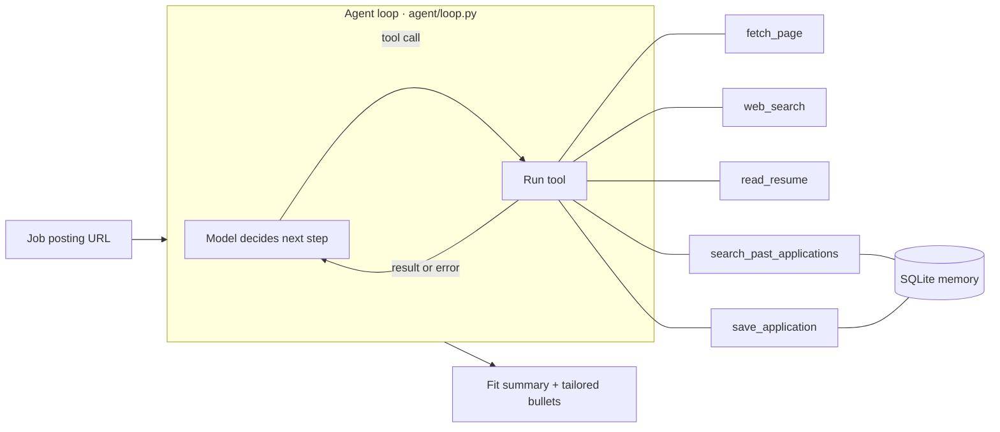

# Job Application Research Agent

An LLM agent that researches a job posting, compares it against your resume, remembers what you've applied to before, and drafts tailored resume bullets, all from a single URL.


Built in Python on the Claude API with a **hand-written tool-calling loop** (no agent framework), **persistent memory** in SQLite, **step-level tracing**, and an **evaluation harness** with an LLM judge.

---

## What it does

Give it a job posting URL and it decides for itself which steps to take:

1. Fetches and reads the posting
2. Researches the company
3. Reads your resume and searches its memory of your past applications
4. Matches your experience to the role and is honest about the gaps
5. Saves the application to long-term memory
6. Returns a fit summary, tailored resume bullets, a "why this company" paragraph, and what it remembers from similar applications

## Example: recovering from a failed fetch

The agent doesn't follow a fixed script. When a step fails, the error goes back to the model, which works out another route. In this real run, the employer's careers page needed JavaScript and came back empty:

```
→ fetch_page(url='https://www.capco.com/en/Careers/Job%20Search/Office%20Detai…')
  ← 72 chars
💭 The posting page returned only site navigation, so I'll try other routes to the job details and check past applications.
→ search_past_applications(query='Capco software developer backend python consulting')
  ← 5128 chars
💭 Greenhouse job IDs usually map to a board URL, so I'll try that.
→ fetch_page(url='https://boards.greenhouse.io/capco/jobs/8072042')
  ← 6492 chars
💭 The Greenhouse board worked and shows the actual role. I'll check Capco's own company page for context.
→ fetch_page(url='https://www.capco.com/en/about-us')
→ save_application(company='Capco', role='AI Prompt Engineering Developer (Toronto)', …)
```

Nothing in the code handles Greenhouse specifically. The agent spotted the job ID in the URL and found the posting on the job board by itself.

## How it works



**The loop.** The model receives the conversation and a list of tools. If it asks to use tools, the loop runs them and sends the results back. This repeats until the model gives a final answer or hits a step limit. The whole loop is about 80 lines in [`agent/loop.py`](agent/loop.py).

**Memory.** Past applications (company, role, summary, and the points you emphasized) are stored in SQLite with full-text search. Memory survives between runs, so when you apply to a similar role, the agent recalls what you emphasized before and adjusts.

**Tracing.** Every model call, tool call, result and token count is printed live and saved to `logs/run-<time>.jsonl`, so you can debug a bad run step by step.

## Evaluation

`evals/run_eval.py` runs the agent on a set of saved postings and scores each answer automatically:

| Check | What it verifies |
|---|---|
| `finished` | Gave a final answer before the step limit |
| `format` | All required sections are present |
| `saved_once` | Saved to memory exactly once |
| `company` | Named the right company |
| `memory_recall` | Recalled a seeded past application (tests long-term memory) |
| `grounded` | A judge model found no claims the resume doesn't support |
| `mentions_gaps` | The fit summary is honest about gaps |

The judge answers through a forced tool call, so its verdict is always structured data rather than free text. Each case runs against a fresh temporary memory database, and results are saved to `evals/results/` so prompt and model changes can be compared run to run.

<!-- Once you've run it, replace this comment with your results, e.g.
**Results:** pass rate improved from 2/4 to 4/4 after revising the system prompt to … -->

## Getting started

Requires Python 3.10+ and an [Anthropic API key](https://console.anthropic.com). Set a monthly spend limit in the console; a run on a small model costs a few cents.

**macOS / Linux**
```bash
python3 -m venv .venv
source .venv/bin/activate
pip install -r requirements.txt
cp .env.example .env                        # add your ANTHROPIC_API_KEY
cp data/resume.example.md data/resume.md    # replace with your own resume
```

**Windows (Command Prompt)**
```
python -m venv .venv
.venv\Scripts\activate
pip install -r requirements.txt
copy .env.example .env
copy data\resume.example.md data\resume.md
```

Web search is optional: add a free [Tavily](https://tavily.com) key as `TAVILY_API_KEY` in `.env` to enable it.

## Usage

```bash
python main.py "https://company.com/careers/some-job"   # research a posting (keep the quotes)
python main.py "https://…" --offline                    # replay cached pages, no network
python main.py --history                                # list saved applications
python evals/run_eval.py                                # run the evaluation
pytest                                                  # tests, no API key needed
```

## Project structure

| Path | Purpose |
|---|---|
| `agent/loop.py` | Agent loop and system prompt |
| `agent/tools.py` | Tool schemas (what the model sees) and implementations, with disk caching |
| `agent/memory.py` | SQLite + full-text search memory |
| `agent/trace.py` | Live step output, JSONL logs, token counts |
| `evals/` | Evaluation cases, runner, and LLM judge |
| `tests/` | Offline tests using a fake model that replays scripted turns |
| `main.py` | Command-line entry point |

## Design decisions

- **Hand-written loop instead of a framework.** Every step is visible and debuggable, and nothing about how the agent decides what to do is hidden behind an abstraction.
- **Errors go back to the model.** A failed fetch becomes information the agent can act on, not a crash, which is what made the recovery above possible.
- **Step limit.** Stops runaway loops and runaway costs.
- **Disk caching.** Re-running a posting costs nothing for fetches, and `--offline` gives a reliable demo and reproducible evaluations where only the model varies.
- **Grounding rule in the prompt, checked by the judge.** The agent may reword your experience but never invent it, and the evaluation verifies that.

## Limitations and next steps

- Pages that need JavaScript can come back empty. The agent often finds another route, but a headless browser would fix this directly.
- Memory search is keyword-based. Embeddings would match related terms like "backend" and "server-side."
- The judge is itself a model and can be wrong; flagged claims are worth a manual look.
- Next: a Streamlit UI that shows the live trace next to the result.

## Tech stack

Python · Claude API (tool use) · SQLite FTS5 · httpx · BeautifulSoup · Rich · pytest
